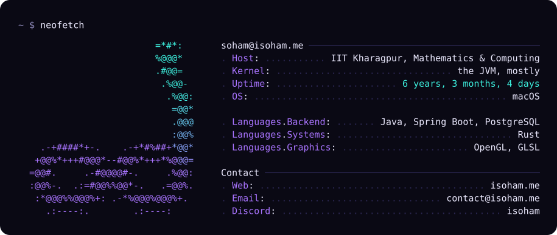

<a href="https://isoham.me">
  <picture>
    <source media="(prefers-color-scheme: dark)" srcset="./assets/card-dark.svg">
    <source media="(prefers-color-scheme: light)" srcset="./assets/card-light.svg">
    
  </picture>
</a>

<picture>
  <source media="(prefers-color-scheme: dark)" srcset="./assets/lattice-dark.svg">
  <source media="(prefers-color-scheme: light)" srcset="./assets/lattice-light.svg">
  
</picture>

<!-- Turn this on once isoham.me/resume is live (showResume: true in the axon repo).
> [!IMPORTANT]
> **Hiring?** My resume is at [isoham.me/resume](https://isoham.me/resume).
-->

  <a href="https://isoham.me">isoham.me</a> ·
  <a href="https://www.linkedin.com/in/isoham1602">LinkedIn</a> ·
  <a href="mailto:contact@isoham.me">contact@isoham.me</a>

